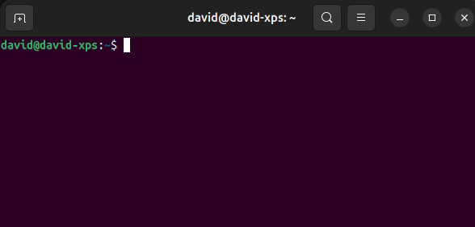

# Sun Accent Popup

Hold a letter to choose an accent, like on macOS. Type accented characters on a
US QWERTY keyboard in compatible Ubuntu/GNOME applications.



Hold **e**, then press **2** for **é**. You can also click an accent or use the
arrow keys and Enter. Press Escape to keep the plain letter. Supports
**a c e i n o s u y z**, including uppercase; ordinary typing stays unchanged.

## Install

All commands below run from a standalone `sun_accent_popup` checkout.

### Debian package · Ubuntu 26.04, x86_64

From the `sun_accent_popup` repository root, install a locally built package on your desktop,
**outside the container**:

```sh
sudo apt install --reinstall ./build/sun-accent-popup_0.1.0_amd64.deb
```

This installs the application, its runtime dependencies, and the IBus component.
No separate registration command is needed. Log out and back in, then add and
select **English → Sun Accent Popup** in **Settings → Keyboard → Input Sources**.
Run `/usr/bin/sun_accent_popup` for the optional practice window.

CI also publishes the Debian package to the GitHub `dev` release after successful
pushes to `main`. See [release and migration instructions](docs/releases.md).

### Build from source · Ubuntu 26.04

Open the `sun_accent_popup` checkout itself in VS Code and select **Dev Containers:
Reopen in Container**. From its repository root inside the container:

```sh
./scripts/install-dependencies.sh
./build.sh --package
```

The installer downloads published `sun_ui` and `sun_gobject` Debian packages
and extracts them into `build/dependencies/`. No subrepositories are cloned or
compiled. The packages must match the installed Sun compiler.

Then install `build/sun-accent-popup_0.1.0_amd64.deb` on your desktop using the
command above. The package build runs the application and IBus registration tests.

Snap installation is also available once published; see the
[Snap instructions](docs/releases.md).

Works through IBus on GNOME Wayland or X11. Applications must support IBus
surrounding text; unsupported applications keep normal typing without the popup.

[Development, troubleshooting, and uninstall instructions](docs/development.md)
